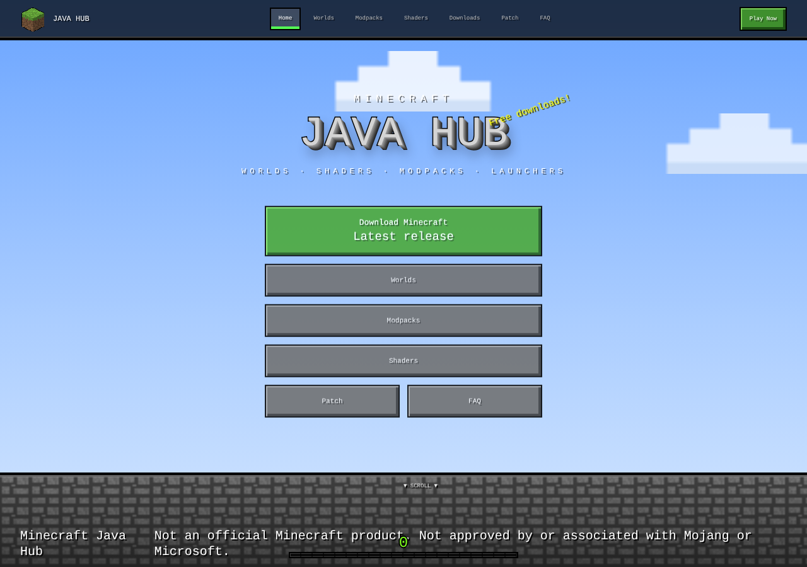

# Minecraft Java Hub

A hub for **Minecraft Java Edition**: downloadable worlds, shaders, modpacks and launchers, designed like the Java game menus. Live site: https://java-minecraft.vercel.app

> Not an official Minecraft product. Not approved by or associated with Mojang or Microsoft.



## Sitemap

| Route | What it is |
| --- | --- |
| `/` | Title screen with a 60 second day/night cycle and the main menu |
| `/worlds` | "Select World" list |
| `/worlds/bulky-star` | Bulky Star world folder |
| `/modpacks` | "Resource Packs" screen: Available and Selected columns |
| `/shaders` | Shader browser with filters |
| `/downloads` | Launcher screen (version dropdown and PLAY), plus the full content library |
| `/patch` | Latest release and snapshot from Mojang, plus the Mrpack to Zip tool |
| `/faq` | Java-chat style FAQ with an AI assistant and an offline fallback |
| `*` | "You died!" 404 |

## Tech stack

Vite, React 18, TypeScript, Tailwind (base only), plain CSS in `src/styles/minecraft.css` (`mc-*` classes), `react-helmet-async` for SEO, Supabase edge functions, Vercel hosting. Fonts: Press Start 2P and VT323.

## Local setup

```bash
npm i
npm run dev            # http://localhost:8080
npm run build          # vite build + per-route head prerender (scripts/prerender.ts)
npm run library:sync   # resolve all sources, write src/data/library.generated.json
npm run library:check  # check every source URL, exit 1 on dead links
```

## Environment variables (names only)

| Name | Where | Purpose |
| --- | --- | --- |
| `VITE_SUPABASE_URL` | site | edge function base URL |
| `VITE_SUPABASE_PUBLISHABLE_KEY` | site | anon key sent to the edge functions |
| `VITE_SITE_URL` | site, optional | overrides `https://java-minecraft.vercel.app` for canonicals and the sitemap |
| `CURSEFORGE_API_KEY` | edge function and `library:sync` | CurseForge Core API (server side only) |
| `GITHUB_TOKEN` | edge function and `library:sync`, optional | avoids GitHub rate limits |
| `SUPABASE_SERVICE_ROLE_KEY` | edge function, optional | reads the `library_entries` table |
| `AI_API_KEY` | `faq-chat` function | AI API key for the FAQ chat |

## Content library

```
content/library.json  --(npm run library:sync)-->  src/data/library.generated.json  (bundled, works offline)
        |                                                    ^
        v                                                    | accepted only if valid and not older
supabase/functions/library-resolve  (1 hour cache) ----------+
```

| Provider | Used for | Verified? |
| --- | --- | --- |
| Mojang version manifest | latest release and snapshot, old releases list | yes |
| Modrinth v2 API | shaders, modpacks, mods (version, size, SHA-512) | yes |
| GitHub Releases | launchers and tools | yes |
| CurseForge Core API | secondary source, needs a key | yes |
| Direct, Google Drive, MediaFire | the owner's own worlds and packs | **no, shown as unverified mirrors** |

- The first source that resolves is primary. The rest are "Mirrors".
- The site reads the bundled file first, then refreshes from the edge function. Remote data is ignored if it has the wrong shape or is older than the bundled file.
- No version number is hard-coded anywhere. If the manifest is missing, the UI says so.
- Shared adapter code lives in `supabase/functions/_shared/library/` and is used by the sync script and the edge function.

## Adding or updating content

See [docs/ADDING_CONTENT.md](docs/ADDING_CONTENT.md). In short: add one object to `content/library.json`, or one row to the optional `library_entries` table.

## Supabase functions

```bash
supabase functions deploy library-resolve --no-verify-jwt
supabase functions deploy faq-chat
supabase secrets set CURSEFORGE_API_KEY=... GITHUB_TOKEN=... AI_API_KEY=...
```

`npm run library:sync` copies `content/library.json` next to the function. Re-deploy `library-resolve` after you change the library.

## Source and trust policy

- **Official:** Mojang (minecraft.net and the version manifest), Modrinth, Prism Launcher on GitHub, and the shader authors' own pages.
- **Unverified mirrors:** Google Drive, MediaFire and direct links. We cannot check these files automatically. They are labelled in red on every card. Scan what you download.
- TLauncher and Legacy Launcher are **not listed** because they are unofficial. They return only if the site owner confirms.
- Expiring links (for example Discord CDN tokens) are not allowed. `library:check` fails on them.

## Deploy

Deploy on Vercel. `vercel.json` holds the single page app rewrite and cache headers. Suggested build command: `npm run library:sync; npm run build` (sync keeps the old file and the build continues if a provider is down). `npm run build` writes `dist/<route>/index.html` for each page so link previews and crawlers see the right title, description and canonical. Submit `https://java-minecraft.vercel.app/sitemap.xml` in Google Search Console and Bing Webmaster Tools.

## Licence and credits

Code by Nextup Studio (Vanshu Agarwal). A licence file has not been chosen yet, so all rights are reserved until one is added. Pixel textures and icons are original or generic. Shaders, launchers and worlds belong to their authors and keep their own licences. Minecraft is a trademark of Mojang Studios.
